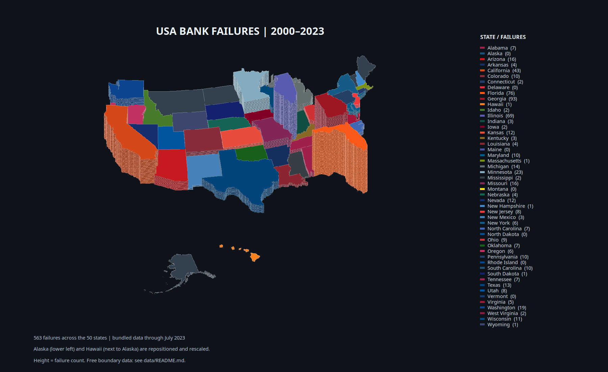

# USA 3D Map

A MATLAB-language visualization of bank failures by US state. Runs in **GNU
Octave for free**, or MATLAB, using bundled state geometry. All application and
rendering code is in `.m` files.

Repository: [Trimmendous/USA-Map-3D](https://github.com/Trimmendous/USA-Map-3D).



## Installation

Install GNU Octave, then open this project folder in Octave. The default map
runs offline and needs no add-on packages. MATLAB R2016b or newer can also read
the bundled JSON; no Financial or Mapping Toolbox is needed for the default map.

The mapping package is only needed if you choose to load a separate shapefile.

## Usage

Open the map:

```matlab
usa
```

Save a still image:

```matlab
usa([], 'output/usa-bank-failures.png');
```

Or from a terminal:

```bash
octave --no-gui --quiet --eval "usa([], 'output/usa-bank-failures.png'); close all;"
```

MATLAB and Octave's Qt backend provide an interactive 3D view. If Octave only
has gnuplot available, the same geometry is drawn with a fixed orthographic
camera using a MATLAB-language rasterizer with a depth buffer. That fallback
does not support 3D rotation. Both paths support PNG export.

To load a geographic shapefile with a `Name` field instead of the bundled data:

```matlab
usa('/path/to/states.shp', 'custom-map.png');
```

Keep its matching `.shx` and `.dbf` files alongside it. This optional path
requires Octave's mapping package or MATLAB's Mapping Toolbox. Rings must be
simple exterior polygons; polygon holes are not supported by this renderer.

## Map and data

- The original alphabetical state colors and one-contour-per-failure style are retained.
- All 50 states are included. Alaska and Hawaii are labeled, rescaled insets.
- Heights represent counts; zero-count states remain flat and gray.
- The bundled CSV has **563 records in the 50 states** for the January 2000–
  December 2023 window. Its latest record is July 2023. Four Puerto Rico records
  are excluded because this map currently covers the 50 states.
- Two-digit CSV years use a 2000 pivot. Quoted fields containing commas are supported.
- Coordinates use a spherical Lambert conformal conic projection with standard
  parallels 33/45 degrees and mainland origin 39/-96 degrees.

## Boundary handling

The original implementation manually split MATLAB's `usastatelo` coordinate
lists to keep islands and separate land areas from being joined. The replacement
dataset explicitly records those separate areas, so the renderer now reads each
ring independently. Triangulation fills concave coastlines; a depth buffer hides
surfaces behind nearer states in the fixed-view export.

See [data/README.md](data/README.md) for source links and simplification details.
These are generalized visualization boundaries.

## Validation

```matlab
addpath('tests');
test_map
```

Checks cover state coverage, bank counts, triangulated polygon areas, and
draw-order-independent depth buffering. MATLAB execution still needs verification;
development checks run in GNU Octave 11.1.

## Future

- Add US territories, including Puerto Rico and Guam.

## Contributing

Contributions are welcome. This project started as an experiment in MATLAB
mapping and 3D visualization.

## License

The application is under the MIT License; see [LICENSE](LICENSE).
Boundary provenance is documented separately in [data/README.md](data/README.md).
